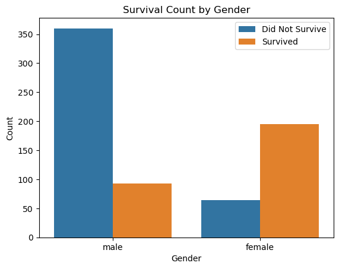
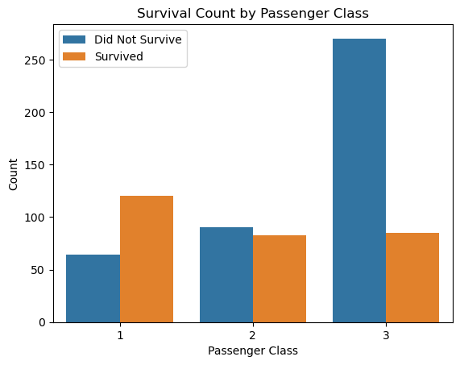
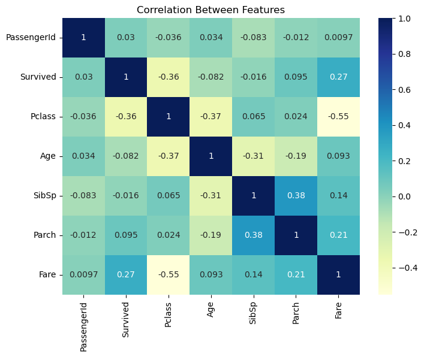

# Titanic Exploratory Data Analysis (EDA)

**Repository:** [github.com/nkongdem/Titanic-Exploratory-Data-Analysis-EDA-](https://github.com/nkongdem/Titanic-Exploratory-Data-Analysis-EDA-)

Exploratory data analysis of the classic Titanic dataset, uncovering the factors most linked to passenger survival through cleaning, summary statistics, and visualization.

## Results

**Survival count by gender**



**Survival count by passenger class**



**Correlation heatmap**



## Overview

This project performs Exploratory Data Analysis (EDA) on the classic Titanic dataset (Kaggle: Machine Learning from Disaster). The goal is to explore patterns in the data, understand the factors affecting passenger survival, and generate actionable insights through visualizations and summary statistics, preparing the dataset for future predictive modeling.

## Objectives

- Explore data types and handle missing values
- Perform data cleaning and type conversion
- Generate summary statistics and group-based insights (e.g., survival rates by gender, class, and age group)
- Visualize key patterns and correlations using bar plots, heatmaps, and other visual tools

## Dataset

**Titanic: Machine Learning from Disaster** (Kaggle) — passenger demographics (age, sex, class) and travel details (fare, embarked, cabin).

## Methodology

1. **Data Preprocessing** — handle missing values, convert data types, remove inconsistencies
2. **Exploratory Analysis** — descriptive statistics, group-based summaries, survival insights
3. **Visualization** — survival rates and correlations via bar plots, heatmaps, and scatter plots

## Key findings

- **Females had higher survival rates than males** — by a wide margin.
- **Passengers in higher classes had better survival chances.**
- **Children had slightly better survival odds than adults.**
- Visualizations reveal key relationships that can inform future predictive models.

## Contents

```
├── EploraData Analysis on Titanic dataset/
│   ├── Exporing Data analysis on titanic dataset.ipynb   # Full EDA notebook
│   └── train.csv                                          # Raw dataset
├── charts/                                                # Result chart images (shown above)
└── README.md
```

## Tools

- Python, Pandas, NumPy
- Matplotlib, Seaborn — visualization

## Future improvements

- Perform feature engineering to prepare data for machine learning
- Build predictive models to estimate survival probabilities
- Deploy an interactive dashboard for dynamic exploration
